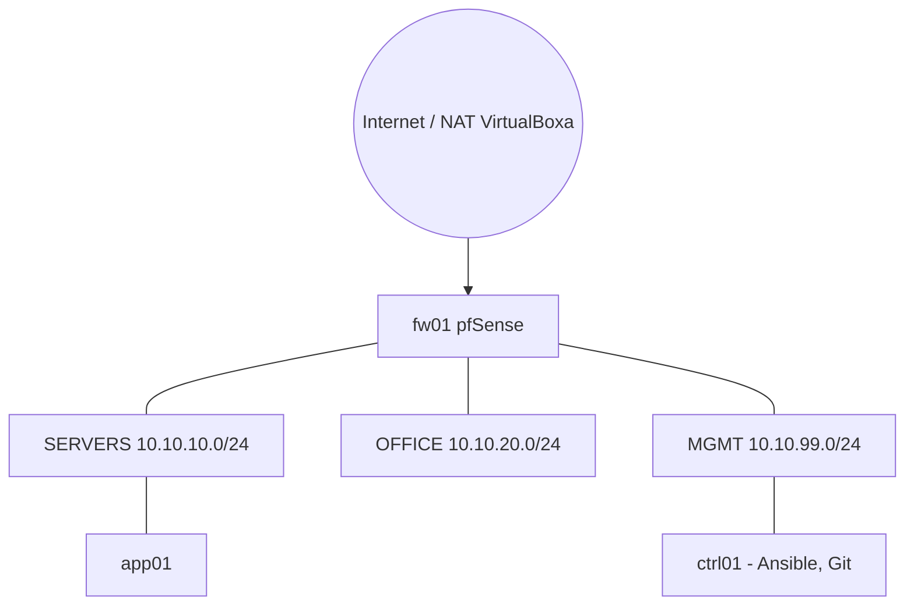

# infra-small-company


Infrastruktura małej firmy opisana jako kod: segmentowana sieć z firewallem pfSense, serwery konfigurowane Ansiblem, sekrety w Ansible Vault i automatyczna kontrola jakości kodu w GitHub Actions. Całość działa lokalnie w VirtualBoxie i jest powtarzalna: maszyny stawia Vagrant, a konfigurację nakłada Ansible.

Projekt powstaje etapami. Status poniżej.

## Status

| Etap | Zakres                                                    | Tag            | Stan      |
| ---- | --------------------------------------------------------- | -------------- | --------- |
| 1    | Sieć: pfSense (`fw01`), 3 segmenty, `ctrl01`, Vagrantfile | `v0.1-network` | gotowe    |
| 2    | Ansible: inventory, rola `common`, Vault, lint w CI       | `v0.2-ansible` | gotowe    |
| 3    | Monitoring (`mon01`): Prometheus, Grafana, Alertmanager   |                | planowane |
| 4    | Aplikacja za HAProxy z SSL (`app01`)                      |                | planowane |
| 5    | Backup i udokumentowany test odtworzenia (`bak01`)        |                | planowane |
| 6    | FreeIPA (`idm01`), VPN WireGuard                          |                | planowane |

## Architektura



### Adresacja

| Segment | Intnet w VirtualBoxie | Podsieć                        | Brama (`fw01`) |
| ------- | --------------------- | ------------------------------ | -------------- |
| WAN     | NAT                   | 10.0.2.0/24 (DHCP VirtualBoxa) | 10.0.2.2       |
| SERVERS | `intnet-servers`      | 10.10.10.0/24                  | 10.10.10.1     |
| OFFICE  | `intnet-office`       | 10.10.20.0/24                  | 10.10.20.1     |
| MGMT    | `intnet-mgmt`         | 10.10.99.0/24                  | 10.10.99.1     |

| Host     | Rola                   | Segment   | Adres                 | System     |
| -------- | ---------------------- | --------- | --------------------- | ---------- |
| `fw01`   | firewall, routing, NAT | wszystkie | .1 w każdym segmencie | pfSense CE |
| `ctrl01` | kontroler Ansible, Git | MGMT      | 10.10.99.10           | Debian 12  |
| `app01`  | serwer aplikacyjny     | SERVERS   | 10.10.10.12           | Debian 12  |

Prawdziwe VLAN-y w VirtualBoxie są kłopotliwe, więc segmenty są symulowane przez sieci wewnętrzne (Internal Network). Dla firewalla działa to tak samo jak osobne interfejsy fizyczne.

### Polityka firewalla (stan na etap 2)

| Segment | Zasada                                                                  |
| ------- | ----------------------------------------------------------------------- |
| MGMT    | wszystko dozwolone (segment administratora)                             |
| SERVERS | wszystko dozwolone, zostanie zawężone po postawieniu usług              |
| OFFICE  | do SERVERS tylko TCP 443 i 22, do internetu dozwolone, reszta blokowana |

Interfejs WWW pfSense jest dostępny z MGMT tylko z hosta `ctrl01` (TCP 443 i 22). Szczegóły i zrzuty ekranu: [`pfsense/README.md`](pfsense/README.md) oraz [`docs/screenshots/`](docs/screenshots/).

## Wymagania

- Windows z VirtualBoxem i Vagrantem (host), Git for Windows
- ok. 4 GB wolnego RAM-u na etapy 1-2 (`fw01` 1 GB, `ctrl01` 1 GB, `app01` 2 GB)
- pfSense CE ISO (AMD64) do ręcznego postawienia `fw01`

## Szybki start

1. **`fw01` ręcznie.** pfSense nie ma sensownego boxa Vagranta, więc maszynę tworzy się z ISO według instrukcji w [`pfsense/README.md`](pfsense/README.md). Konfiguracja referencyjna: `pfsense/config.sanitized.xml`.
2. **Maszyny Vagranta** (na hoście, w katalogu repo):
   ```bash
   vagrant up
   ```
3. **Klucz SSH kontrolera.** Na `ctrl01` wygeneruj klucz `~/.ssh/ansible_ed25519` i dopisz jego część publiczną do `authorized_keys` użytkownika `vagrant` na `app01`. Ten krok jest na razie ręczny.
4. **Sekrety.** Na `ctrl01` utwórz plik z hasłem do Vaulta (`~/.vault_pass`, uprawnienia `600`). Zaszyfrowany plik `ansible/group_vars/all/vault.yml` jest w repo, ale bez tego hasła jest nieczytelny.
5. **Konfiguracja Ansiblem** (na `ctrl01`):
   ```bash
   cd ~/infra-small-company
   ansible-galaxy collection install -r ansible/requirements.yml
   cd ansible
   ansible all -m ping
   ansible-playbook site.yml --check --diff   # podgląd zmian
   ansible-playbook site.yml
   ```
   Drugie uruchomienie `site.yml` powinno zakończyć się `changed=0` (idempotentność).

## Struktura repozytorium

```
infra-small-company/
├── Vagrantfile                  # definicja maszyn i sieci
├── .yamllint                    # reguły yamllint
├── .ansible-lint                # reguły ansible-lint
├── .github/workflows/lint.yml   # CI: yamllint + ansible-lint
├── ansible/
│   ├── ansible.cfg
│   ├── requirements.yml         # wymagane kolekcje Ansible
│   ├── site.yml                 # główny playbook
│   ├── inventory/hosts.yml
│   ├── group_vars/all/
│   │   ├── vars.yml             # zmienne jawne (odwołania do sekretów)
│   │   └── vault.yml            # sekrety, zaszyfrowane Ansible Vault
│   ├── host_vars/               # wyjątki dla pojedynczych hostów
│   └── roles/common/
│       ├── defaults/main.yml    # domyślne wartości zmiennych roli
│       ├── tasks/main.yml       # zadania
│       ├── handlers/main.yml    # restart sshd tylko po zmianie
│       └── templates/sshd_hardening.conf.j2
├── pfsense/
│   ├── config.sanitized.xml     # konfiguracja bez haseł i kluczy
│   └── README.md
└── docs/
    ├── architecture.md
    ├── decisions/               # decyzje projektowe (ADR)
    ├── runbooks/
    └── screenshots/
```

## Rola `common`

Stosowana na wszystkich hostach. Efekt: każdy serwer ma tę samą, bezpieczną bazę.

- **Pakiety bazowe** (vim, curl, git, htop, tmux, rsync, narzędzia sieciowe, chrony, sudo)
- **Strefa czasowa** `Europe/Warsaw` i synchronizacja czasu (chrony)
- **Hardening SSH** jako plik drop-in `/etc/ssh/sshd_config.d/00-hardening.conf` generowany z szablonu: brak logowania root, brak logowania hasłem, limit prób, lista dozwolonych użytkowników (`AllowUsers`), wyłączony forwarding X11/agenta. Przed restartem `sshd` handler sprawdza składnię (`sshd -t`), więc błędna konfiguracja nie odetnie dostępu do działającej usługi.
- **Konto administratora** w grupie `sudo` z kluczem SSH z kontrolera. Hash hasła jest w Ansible Vault.
- **Sudo bez hasła dla konta automatyzacji** przez osobny plik w `/etc/sudoers.d/`, walidowany `visudo -cf` przed zapisem. Świadomy kompromis: Ansible uruchamiany bez człowieka nie może pytać o hasło.

Wartości domyślne są w `defaults/main.yml`, a wyjątki per host w `host_vars/` (np. `ctrl01` ma włączony `AllowTcpForwarding`, bo służy do tunelu na panel pfSense).

## Sekrety

- Hasła i hashe trzymane są wyłącznie w `ansible/group_vars/all/vault.yml`, zaszyfrowanym przez Ansible Vault.
- Hasło do Vaulta leży poza repozytorium (`~/.vault_pass` na kontrolerze).
- Konfiguracja pfSense w repo jest oczyszczona z hashy haseł, certyfikatów i kluczy prywatnych.
- Przed każdym commitem: `git status` i sprawdzenie, że żaden plik z sekretem nie jest dodawany jawnie.

## Kontrola jakości (CI)

Po każdym `git push` GitHub Actions uruchamia:

- `yamllint`: poprawność i spójność formy plików YAML,
- `ansible-lint`: poprawność i dobre praktyki kodu Ansible (pełne nazwy modułów, opisowe nazwy zadań, uprawnienia plików itd.).

Kolekcje Ansible potrzebne linterowi są w `ansible/requirements.yml`, więc CI i środowisko lokalne używają tych samych zależności. Zaszyfrowany plik Vaulta jest wyłączony z kontroli.

## Problemy i wnioski

**1. `AllowUsers` z przecinkiem odcięło dostęp do serwera.** Wpisałem `vagrant,admin`, a `sshd` rozdziela użytkowników spacjami, więc czytał to jako jedno nieistniejące konto. Objaw: `Permission denied (publickey)` mimo poprawnego klucza. Dostęp odzyskałem przez konsolę VirtualBoxa. Wniosek: lista użytkowników to lista w YAML składana filtrem `join(' ')` w szablonie, a przed zmianą hardeningu trzymam drugą, otwartą sesję SSH.

**2. `authorized_key` kończył się błędem w trybie `--check`.** W trybie suchym zadanie tworzące użytkownika nic nie robi, więc kolejne zadanie nie znajdowało jego katalogu domowego. Wniosek: tryb `--check` ma ograniczenia przy zadaniach zależnych od stanu utworzonego przez poprzednie zadania.

**3. `No package matching 'vim' is available` przy pierwszym przebiegu.** Świeża maszyna z boxa miała puste listy pakietów, a `cache_valid_time` uznawał cache za aktualny. Rozwiązanie: odświeżenie indeksu apt (`update_cache`) przed instalacją. <!-- TODO: potwierdź, czy to była faktyczna przyczyna u Ciebie -->

**4. Hasło użytkownika to hash, nie tekst.** Moduł `user` oczekuje hasha SHA-512. Hash generuję raz i trzymam w Vaulcie, a zadanie ma `update_password: on_create`, żeby Ansible nie nadpisywał hasła zmienionego przez użytkownika.

**5. Linter nie widział modułów z kolekcji.** `ansible-lint` zainstalowany przez `pipx` działa w osobnym środowisku bez kolekcji `community.general` i `ansible.posix`. Rozwiązanie: plik `requirements.yml` jako jedno źródło zależności dla środowiska lokalnego i CI.

**6. pfSense ciągle uruchamiał instalator.** Maszyna startowała z ISO. Rozwiązanie: odpięcie obrazu z napędu i ustawienie dysku jako pierwszego w kolejności rozruchu.

## Znane ograniczenia

- Maszyny Vagranta mają kartę NAT jako domyślną trasę do internetu, więc ruch wychodzący z `app01` omija `fw01`. Przekierowanie trasy domyślnej na firewall wymaga osobnego rozwiązania, bo Vagrant łączy się z maszynami właśnie przez NAT.
- Dystrybucja klucza SSH kontrolera na `app01` jest ręczna.
- `host_key_checking = False` w `ansible.cfg` to świadomy kompromis laboratorium.

## Pomiary

| Miara                                                          | Wartość     |
| -------------------------------------------------------------- | ----------- |
| Czas `vagrant up` (ctrl01 + app01)                             | _uzupełnij_ |
| Czas pełnego `ansible-playbook site.yml` na świeżych maszynach | _uzupełnij_ |
| Liczba ról / hostów                                            | 1 / 2       |
| Drugi przebieg playbooka                                       | `changed=0` |

## Roadmap

- Monitoring: Prometheus, Grafana, Alertmanager, `node_exporter` na wszystkich hostach, alerty na Telegram lub e-mail
- Aplikacja w Docker Compose za HAProxy na pfSense z SSL
- Backup (restic lub Borg) z harmonogramem i udokumentowanym testem odtworzenia
- FreeIPA i logowanie klienta przez IPA
- VPN WireGuard do segmentu MGMT
- Trasa domyślna serwerów przez `fw01`
